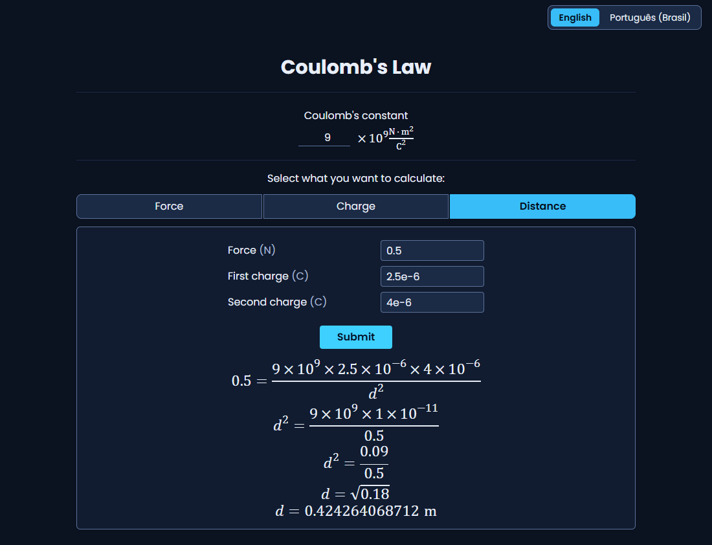
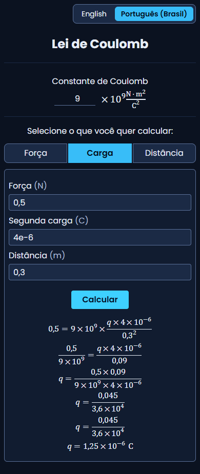

# Coulomb's Law

**English** | [Português (Brasil)](README.pt-BR.md)

<div align="center">
	<h5>
		A website that calculates the force, charge or distance between two stationary electric charges
		<br>
		Every step of the calculation is shown
	</h5>
	<a href="https://coulomb-law.vercel.app">Live site</a>
</div>

<br>

<p align="center">
	<a href="https://github.com/Alphka/Coulombs-Law/actions/workflows/ci.yml">
		
	</a>
	<a href="LICENSE.md">
		
	</a>
	
	
	
</p>

## About

The page has three calculators. Given Coulomb's constant and any two of the other three quantities, you can find the missing one:

- **Force** from the two charges and the distance between them.
- **Charge** (the first one) from the force, the second charge and the distance.
- **Distance** from the force and the two charges.

Each result is shown as a sequence of algebraic steps, so you can follow how the value was obtained. The interface is available in English and in Brazilian Portuguese.

<p align="center">
	
	
</p>

## Formula and units

The app implements Coulomb's law for two point charges:

$$F = k \cdot \frac{|q_1| \cdot |q_2|}{d^2}$$

| Symbol | Meaning | Unit |
|---|---|---|
| `F` | Electrostatic force | newton (N) |
| `k` | Coulomb's constant | N·m²/C² |
| `q₁`, `q₂` | Electric charges | coulomb (C) |
| `d` | Distance between the charges | meter (m) |

Rearranged by the app, as implemented in [`src/app/helpers/calculate.ts`](src/app/helpers/calculate.ts):

- Charge: `q₁ = F · d² / (k · |q₂|)`
- Distance: `d = √(k · |q₁| · |q₂| / F)`

> [!NOTE]
> Coulomb's constant is entered as a coefficient of 10⁹ N·m²/C² and must be between `8.9` and `9` (default `9`). The list of suggestions offers `8.998`, `8.99`, `8.9` and `9`.
>
> Charges are used as magnitudes (absolute values), so the force is the magnitude of the force, not its direction (attractive or repulsive).

## Input rules

- Numbers may use a decimal point or a comma, and scientific notation, such as `3`, `.5`, `0,5` or `1.6e-19`. The exponent must be between -1000 and 1000.
- The distance must be greater than zero.
- Charge calculator: the force cannot be negative and the second charge cannot be zero.
- Distance calculator: the force must be greater than zero.
- An invalid field is marked, focused and named in the message.

## Features

- Three calculators in an accessible tabs pattern (the arrow keys, `Home` and `End` switch the tab).
- Exact arithmetic with [fraction.js](https://github.com/rawify/Fraction.js), so there is no floating-point noise such as `12.250000000000002`. Values are shown with 12 significant digits.
- Steps written in native MathML, announced to screen readers. No math library is bundled.
- English and Brazilian Portuguese ([next-intl](https://next-intl.dev/)), with the decimal separator of each language.
- `Enter` moves to the next field and submits on the last one.
- Responsive, dark-only layout styled with Tailwind CSS classes.

> [!NOTE]
> The page needs JavaScript enabled.

## Tech stack

- [Next.js](https://nextjs.org/) 16 (App Router) and [React](https://react.dev/) 19
- [TypeScript](https://www.typescriptlang.org/)
- [Tailwind CSS](https://tailwindcss.com/) v4
- [next-intl](https://next-intl.dev/) for the translations
- [fraction.js](https://github.com/rawify/Fraction.js) for the exact arithmetic
- [Jest](https://jestjs.io/) and [Testing Library](https://testing-library.com/) for the tests
- [ESLint](https://eslint.org/) and [cspell](https://cspell.org/) for the code style and the spelling
- [pnpm](https://pnpm.io/) as the package manager

## Requirements

- [Node.js](https://nodejs.org/) `22.22.2` or later. The CI workflow checks the project on the latest release of Node.js 22, 24 and 26.
- [pnpm](https://pnpm.io/) `11` or `12`. The exact version is pinned in the `packageManager` field of `package.json`, so it is selected automatically.

## Installation

```sh
git clone https://github.com/Alphka/Coulombs-Law.git
cd Coulombs-Law
pnpm install
```

## Usage

Start the development server (with hot reload) at <http://localhost:3000>:

```sh
pnpm dev
```

Build the site and serve the production build:

```sh
pnpm build
pnpm start
```

### Scripts

| Script | Description |
| --- | --- |
| `pnpm dev` | Starts the Next.js development server |
| `pnpm build` | Builds the site for production |
| `pnpm start` | Serves the production build |
| `pnpm tsc` | Generates the route and message types, then type-checks the project |
| `pnpm lint` | Runs ESLint and cspell |
| `pnpm lint:fix` | Runs ESLint and fixes what it can |
| `pnpm test` | Runs the tests |

## Browser support

The supported browsers are listed in the `browserslist` field of `package.json` (Chrome and Edge 111+, Firefox 128+, Safari and iOS 16.4+). All of them support MathML.

## Deployment

The site is deployed on [Vercel](https://vercel.com/). The [`vercel.json`](vercel.json) file only sets the Next.js framework, so the project settings in the dashboard do not need to be changed. The security headers are set in [`next.config.ts`](next.config.ts).

## Project structure

```text
messages/            Translations (en.json is the source of the message types)
src/
├── app/
│   ├── [locale]/    Pages: layout, home and not found
│   ├── components/  Calculator, Tabs, CalculatorForm, NumberField, ConstantField, Result, MathView, LanguageSwitcher
│   ├── entities/    CalculationError
│   ├── helpers/     calculate, calculators (the fields of each calculator), math (MathML nodes and number formatting), parseNumber
│   └── globals.css  Tailwind theme (colors) and the base styles
├── i18n/            next-intl routing, request configuration and navigation
├── testing/         Test helpers
├── typings/         Type declarations (MathML elements, next-intl)
└── proxy.ts         Locale routing
.github/             CI workflow and the screenshots used in this README
```

## Tests

`pnpm test` runs the unit tests of the calculations, the number formatting and the messages, and the component tests of the calculator. Most expected steps come from the implementation that existed before version 3.0.0, so the steps stay the same, apart from the intended fixes.

## License

[ISC](LICENSE.md) © 2022 Kayo Souza
