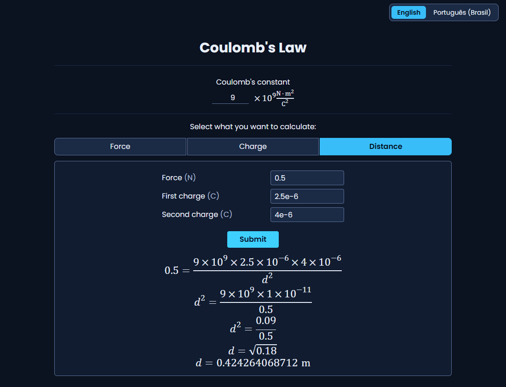
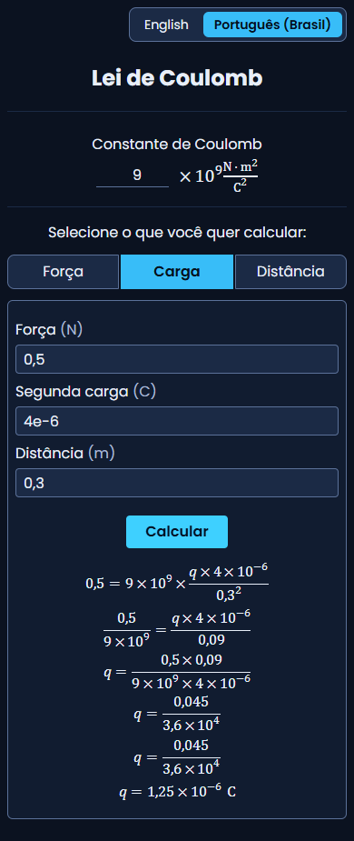

# Lei de Coulomb

[English](README.md) | **Português (Brasil)**

<div align="center">
	<h5>
		Um site que calcula a força, a carga ou a distância entre duas cargas elétricas em repouso
		<br>
		Cada passo do cálculo é mostrado
	</h5>
	<a href="https://coulomb-law.vercel.app/pt-BR">Site publicado</a>
</div>

<br>

<p align="center">
	<a href="https://github.com/Alphka/Coulombs-Law/actions/workflows/ci.yml">
		
	</a>
	<a href="LICENSE.md">
		
	</a>
	
	
	
</p>

## Sobre

A página tem três calculadoras. Com a constante de Coulomb e duas das outras três grandezas, você encontra a que falta:

- **Força**, a partir das duas cargas e da distância entre elas.
- **Carga** (a primeira), a partir da força, da segunda carga e da distância.
- **Distância**, a partir da força e das duas cargas.

Cada resultado aparece como uma sequência de passos algébricos, para você acompanhar como o valor foi obtido. A interface está disponível em inglês e em português do Brasil.

<p align="center">
	
	
</p>

## Fórmula e unidades

O app implementa a lei de Coulomb para duas cargas pontuais:

$$F = k \cdot \frac{|q_1| \cdot |q_2|}{d^2}$$

| Símbolo | Significado | Unidade |
|---|---|---|
| `F` | Força eletrostática | newton (N) |
| `k` | Constante de Coulomb | N·m²/C² |
| `q₁`, `q₂` | Cargas elétricas | coulomb (C) |
| `d` | Distância entre as cargas | metro (m) |

Rearranjada pelo app, como implementado em [`src/app/helpers/calculate.ts`](src/app/helpers/calculate.ts):

- Carga: `q₁ = F · d² / (k · |q₂|)`
- Distância: `d = √(k · |q₁| · |q₂| / F)`

> [!NOTE]
> A constante de Coulomb é informada como o coeficiente de 10⁹ N·m²/C² e deve estar entre `8.9` e `9` (padrão `9`). A lista de sugestões oferece `8.998`, `8.99`, `8.9` e `9`.
>
> As cargas são usadas em módulo (valor absoluto), então a força é o módulo da força, não a direção (atração ou repulsão).

## Regras dos campos

- Os números podem usar ponto ou vírgula como separador decimal e notação científica, como `3`, `.5`, `0,5` ou `1.6e-19`. O expoente deve estar entre -1000 e 1000.
- A distância deve ser maior que zero.
- Calculadora de carga: a força não pode ser negativa e a segunda carga não pode ser zero.
- Calculadora de distância: a força deve ser maior que zero.
- O campo inválido é marcado, recebe o foco e é citado na mensagem.

## Funcionalidades

- Três calculadoras em um padrão de abas acessível (as setas, `Home` e `End` trocam de aba).
- Aritmética exata com [fraction.js](https://github.com/rawify/Fraction.js), sem ruído de ponto flutuante como `12.250000000000002`. Os valores são mostrados com 12 algarismos significativos.
- Passos escritos em MathML nativo, anunciados para leitores de tela. Nenhuma biblioteca de matemática é empacotada.
- Inglês e português do Brasil ([next-intl](https://next-intl.dev/)), com o separador decimal de cada idioma.
- `Enter` vai para o próximo campo e envia no último.
- Layout responsivo, somente escuro, estilizado com classes do Tailwind CSS.

> [!NOTE]
> A página precisa de JavaScript habilitado.

## Tecnologias

- [Next.js](https://nextjs.org/) 16 (App Router) e [React](https://react.dev/) 19
- [TypeScript](https://www.typescriptlang.org/)
- [Tailwind CSS](https://tailwindcss.com/) v4
- [next-intl](https://next-intl.dev/) para as traduções
- [fraction.js](https://github.com/rawify/Fraction.js) para a aritmética exata
- [Jest](https://jestjs.io/) e [Testing Library](https://testing-library.com/) para os testes
- [ESLint](https://eslint.org/) e [cspell](https://cspell.org/) para o estilo do código e a ortografia
- [pnpm](https://pnpm.io/) como gerenciador de pacotes

## Requisitos

- [Node.js](https://nodejs.org/) `22.22.2` ou superior. O workflow de CI verifica o projeto na última versão do Node.js 22, 24 e 26.
- [pnpm](https://pnpm.io/) `11` ou `12`. A versão exata fica fixada no campo `packageManager` do `package.json`, então é selecionada automaticamente.

## Instalação

```sh
git clone https://github.com/Alphka/Coulombs-Law.git
cd Coulombs-Law
pnpm install
```

## Uso

Inicie o servidor de desenvolvimento (com hot reload) em <http://localhost:3000>:

```sh
pnpm dev
```

Gere o site e sirva o build de produção:

```sh
pnpm build
pnpm start
```

### Scripts

| Script | Descrição |
| --- | --- |
| `pnpm dev` | Inicia o servidor de desenvolvimento do Next.js |
| `pnpm build` | Gera o site para produção |
| `pnpm start` | Serve o build de produção |
| `pnpm tsc` | Gera os tipos das rotas e das mensagens e verifica os tipos do projeto |
| `pnpm lint` | Executa o ESLint e o cspell |
| `pnpm lint:fix` | Executa o ESLint e corrige o que for possível |
| `pnpm test` | Executa os testes |

## Navegadores suportados

Os navegadores suportados estão listados no campo `browserslist` do `package.json` (Chrome e Edge 111+, Firefox 128+, Safari e iOS 16.4+). Todos suportam MathML.

## Deploy

O site está publicado na [Vercel](https://vercel.com/). O arquivo [`vercel.json`](vercel.json) só define o framework Next.js, então as configurações do projeto no painel não precisam ser alteradas. Os cabeçalhos de segurança ficam em [`next.config.ts`](next.config.ts).

## Estrutura do projeto

```text
messages/            Traduções (en.json é a origem dos tipos das mensagens)
src/
├── app/
│   ├── [locale]/    Páginas: layout, início e não encontrada
│   ├── components/  Calculator, Tabs, CalculatorForm, NumberField, ConstantField, Result, MathView, LanguageSwitcher
│   ├── entities/    CalculationError
│   ├── helpers/     calculate, calculators (os campos de cada calculadora), math (nós MathML e formatação dos números), parseNumber
│   └── globals.css  Tema do Tailwind (cores) e estilos base
├── i18n/            Rotas do next-intl, configuração da requisição e navegação
├── testing/         Auxiliares dos testes
├── typings/         Declarações de tipos (elementos MathML, next-intl)
└── proxy.ts         Roteamento por idioma
.github/             Workflow de CI e as capturas de tela usadas neste README
```

## Testes

`pnpm test` executa os testes unitários dos cálculos, da formatação dos números e das mensagens, e os testes de componente da calculadora. A maioria dos passos esperados vem da implementação que existia antes da versão 3.0.0, então os passos continuam os mesmos, exceto pelas correções intencionais.

## Licença

[ISC](LICENSE.md) © 2022 Kayo Souza
